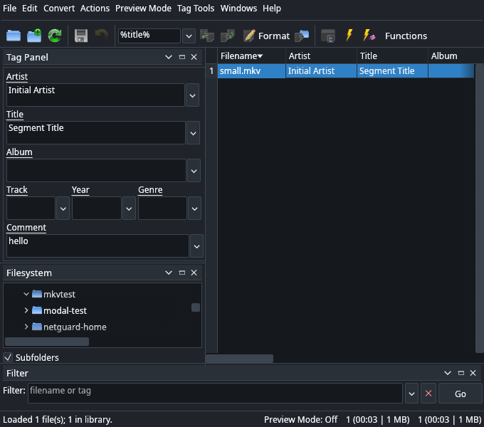

# PuddleMore


PuddleMore is a spreadsheet-style audio and video metadata editor for Linux.
It is written in Rust and uses egui, so it runs without a Python runtime. The
layout follows puddletag: editable tag columns, the Tag Panel, Filesystem,
Filter, Artwork, Logs and Stored Tags docks, Actions, Functions, and the
familiar menus and toolbar.

PuddleMore reads and writes tags across common lossy and lossless formats. It
ships native Matroska, AIFF and APEv2 engines for the cases where TagLib is not
enough, and uses TagLib's C bindings for the rest.



## Features

- Editable spreadsheet with sorting, filtering, multi-selection, Tag Panel,
  Extended Tags, column visibility, row numbers and status statistics.
- Undo/redo, Preview Mode, Write Previews and Clear Previews.
- Actions and Functions built on `%field%` and `$function(...)` patterns.
- Convert menu: File→Tag, Tag→File, Format and Rename Directories.
- Artwork support: add, replace, remove and save embedded cover art.
- Tag Tools for removing ID3v1, ID3v2, all ID3 and APEv2 tags.
- M3U playlist load/save, CSV/HTML/RTF/TXT/M3U export, Logs, Stored Tags and
  file deletion.
- High-contrast System, Light and Dark themes in Preferences → Appearance.
- Native Matroska support for Segment Info `Title`, global tags, arbitrary tag
  names, targeted tags, cover art and non-image attachments.
- Native AIFF/AIFC chunks, native APEv2 for TTA, and TagLib coverage for the
  MP3, FLAC, Ogg, Opus, MP4, WAV, WavPack, APE, MPC, WMA/ASF, DSF/DFF and
  related families.
- Command line mode that prints tags as text or JSON and edits tags without
  opening the GUI.

## Supported formats

| Container | Extensions |
| --- | --- |
| ID3v1/ID3v2 | `.mp1`, `.mp2`, `.mp3`, `.wav`, `.wave`, `.aif`, `.aifc`, `.aiff`, `.tta` |
| MP4 atoms | `.mp4`, `.m4a`, `.m4b`, `.m4v` |
| Vorbis comments | `.ogg`, `.oga`, `.opus`, `.spx`, `.flac` |
| APEv2 | `.ape`, `.wv`, `.mpc`, `.tta`, `.tak`, `.ofr` |
| Windows Media | `.wma`, `.wmv`, `.asf` |
| Matroska | `.mka`, `.mkv`, `.webm` |

DSF/DFF, TAK, Monkey's Audio, Musepack and OptimFROG are handled through
TagLib's property map. The test environment has no encoder for them, so they do
not have end-to-end fixtures here.

## Requirements

- A Linux system with an X11 or Wayland session
- Rust and Cargo (edition 2021)
- TagLib C 2.x development headers, which provide `libtag_c`
  - Debian/Ubuntu: `sudo apt install libtagc0-dev`
  - Fedora: `sudo dnf install taglib-devel`

## Build and run

The launcher builds the binary on first use and then runs it:

```sh
cd "PuddleTag Source Code"
./PuddleMore
```

Pass files or folders to open them directly. Folders are scanned recursively.

```sh
./PuddleMore song.mkv Album/
```

To build manually:

```sh
cd "PuddleTag Source Code/rust"
cargo build --release
./target/release/puddlemore
```

The launcher uses `rust/target/release/puddlemore` when it exists. Set
`PUDDLEMORE_BIN` to run a different binary, or `CARGO` to choose a Cargo
executable. A desktop entry is available at
`PuddleTag Source Code/PuddleMore.desktop`; it expects the `PuddleMore`
launcher to be on `PATH` and an installed icon named `PuddleMore`.

## Command line

```sh
# Open the GUI, with optional files or folders
puddlemore
puddlemore song.mkv Album/

# Print every field, including read-only file information
puddlemore --print song.mkv

# Print as JSON
puddlemore --print --json Album/

# Set tags without the GUI
puddlemore --set 'title=New title' --set year=2026 song.mkv

# An empty value removes the field
puddlemore --set 'comment=' song.flac
```

## Keyboard shortcuts

| Shortcut | Action |
| --- | --- |
| `Ctrl+S` | Save, or write previews when Preview Mode is on |
| `Ctrl+Z` | Undo |
| `Ctrl+Shift+Z` | Redo |
| `Ctrl+Shift+P` | Toggle Preview Mode |
| `Enter` | Commit the current cell |
| `Escape` | Cancel cell editing |

Double-click a cell to edit it. Files can also be dragged onto the window.

## Project layout

```text
PuddleMore/
├── PuddleTag Source Code/
│   ├── PuddleMore            launcher
│   ├── PuddleMore.desktop    desktop entry
│   ├── PuddleMore.png        application icon
│   ├── LICENSE, copyright, THANKS
│   └── rust/
│       ├── src/main.rs       UI, menus, dialogs and CLI
│       ├── src/metadata.rs   format-neutral tag model
│       ├── src/taglib.rs     TagLib C engine
│       ├── src/matroska.rs   native Matroska engine
│       ├── src/aiff.rs       native AIFF/AIFC chunks
│       ├── src/apev2.rs      native APEv2 reader/writer
│       ├── src/tagtools.rs   ID3 and APEv2 removal
│       ├── src/pattern.rs    %field% pattern evaluator
│       ├── src/actions.rs    saved actions
│       ├── src/export.rs     tag export
│       ├── src/playlist.rs   M3U playlists
│       ├── src/config.rs     settings
│       └── src/theme.rs      System, Light and Dark palettes
├── screenshots/
├── PuddleMore_PROJECT_SUMMARY.md
└── README.md
```

## Development

```sh
cd "PuddleTag Source Code/rust"
cargo fmt --check
cargo test
cargo build --release
```

The tests cover column labels, JSON escaping, APEv2 keys and footers, AIFF
chunk mapping, actions, pattern rendering, filename parsing, playlists,
export, ID3 removal and the metadata engines.

The Matroska reader memory-maps the file and parses only the metadata regions.
Saves rebuild the segment atomically when tags outgrow their reserved space.

## Known limits

- WMA/WMV/ASF use TagLib's ASF property map. Attributes that TagLib does not
  expose are not editable.
- Matroska track and chapter targeted tags and non-image attachments are
  preserved, but they are not shown as editable table columns.
- The Matroska writer rebuilds the segment on save. It does not stream unchanged
  clusters to a temporary file yet.
- Raw AC3 and DTS bitstreams are not scanned because they have no supported tag
  container.
- PuddleMore covers the core tag editor. The puddletag music library, duplicate
  finder, mass-tagging profiles, plugin loader, shortcut editor and
  text-file/clipboard-to-tag tools were not carried over.

## Documentation

- [PuddleMore_PROJECT_SUMMARY.md](PuddleMore_PROJECT_SUMMARY.md) covers
  architecture, supported formats, verification and known limits.
- [PuddleTag Source Code/README.md](PuddleTag%20Source%20Code/README.md) covers
  build steps, features and the format matrix.
- [PuddleTag Source Code/rust/README.md](PuddleTag%20Source%20Code/rust/README.md)
  covers the CLI, metadata engines and tests.

## License

PuddleMore is based on puddletag by concentricpuddle and is distributed under
the GNU General Public License, version 3 or later. See
[LICENSE](PuddleTag%20Source%20Code/LICENSE) and
[copyright](PuddleTag%20Source%20Code/copyright). The application icons come
from the Oxygen Project and are licensed under the GPLv3. Additional credits
are in [THANKS](PuddleTag%20Source%20Code/THANKS).
