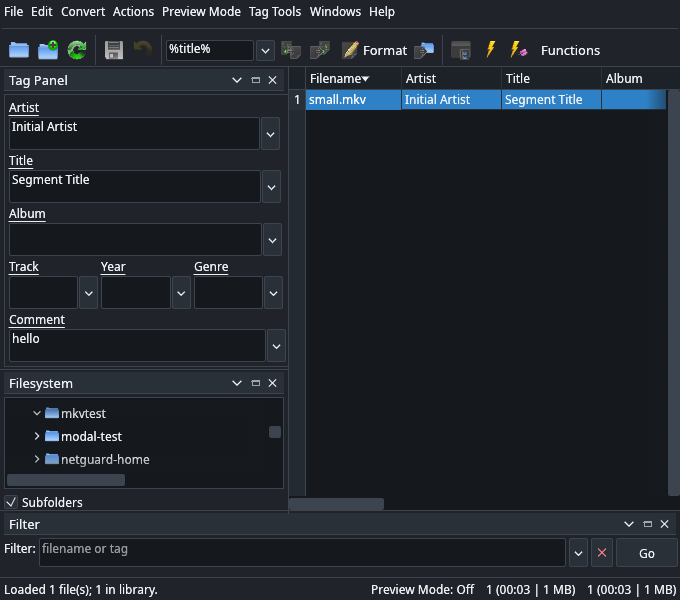

# PuddleMore


PuddleMore is a spreadsheet-style audio and video metadata editor for Linux. It
is a puddletag fork that keeps the original PyQt6 interface and layout, adds
PuddleMore branding, high-contrast System/Light/Dark themes, extra container
support and a Rust metadata engine for formats mutagen does not cover.

| Light theme | Dark theme |
| --- | --- |
|  |  |

## Features

- Original puddletag spreadsheet UI with the Tag Panel, Artwork, Filesystem,
  Filter, Logs, Stored Tags, Actions, Functions, Preview Mode and Extended Tags.
- High-contrast System, Light and Dark themes under Preferences → Appearance.
- Matroska/WebM/MKA support for Segment Info `Title`, global and targeted tags,
  attachments and cover art.
- TTA APEv2, native AIFF/AIFC text chunks, WAV/WAVE, MP1/MP2, M4B, OGA and
  WMA/ASF extension routing.
- Playlists, tag export, tag tools, file renaming and the original puddletag
  workflows.
- Rust CLI for scripting and native metadata work.

## Requirements

- Linux with an X11 or Wayland session
- Python 3.10 or newer
- Python packages from `requirements.txt`
- Rust and Cargo, only when the Rust helper needs to be built
- TagLib C 2.x runtime library for the Rust helper
  - Debian/Ubuntu: `sudo apt install libtagc0`
  - Fedora: `sudo dnf install taglib`
- TagLib C development headers, only when building the Rust helper
  - Debian/Ubuntu: `sudo apt install libtagc0-dev`
  - Fedora: `sudo dnf install taglib-devel`

Set up a virtual environment and install the Python dependencies:

```sh
python3 -m venv .venv
.venv/bin/pip install -r requirements.txt
```

## Run

```sh
./PuddleMore
```

Pass files or folders to open them directly:

```sh
./PuddleMore song.mkv Album/
```

The launcher uses `.venv/bin/python` when it exists and falls back to
`python3`. If the Rust helper is missing, it builds
`rust/target/release/puddlemore` on first use when Cargo is available.

The desktop entry `PuddleMore.desktop` expects the `PuddleMore` launcher to be
on `PATH` and an installed icon named `PuddleMore`.

## Formats

| Container | Extensions |
| --- | --- |
| ID3v1/ID3v2 | `.mp1`, `.mp2`, `.mp3`, `.wav`, `.wave`, `.aif`, `.aifc`, `.aiff`, `.tta` |
| MP4 atoms | `.mp4`, `.m4a`, `.m4b`, `.m4v` |
| Vorbis comments | `.ogg`, `.oga`, `.opus`, `.spx`, `.flac` |
| APEv2 | `.ape`, `.wv`, `.mpc`, `.tta`, `.tak`, `.ofr` |
| Windows Media | `.wma`, `.wmv`, `.asf` |
| Matroska | `.mka`, `.mkv`, `.webm` |

## Rust helper

The Rust application in `rust/` is the metadata adapter for Matroska, TTA/APEv2,
native AIFF and WAV. It also provides a standalone CLI and egui interface. Build
it manually with:

```sh
cd rust
cargo build --release
```

The Python bridge uses `rust/target/release/puddlemore`. Set `PUDDLEMORE_BIN` to
point it at another binary.

```sh
rust/target/release/puddlemore --print song.mkv
rust/target/release/puddlemore --print --json Album/
rust/target/release/puddlemore --set 'title=New title' --set year=2026 song.mkv
```

See [rust/README.md](rust/README.md) for the engine details.

## Development

```sh
.venv/bin/python -m compileall -q puddlestuff puddlemore_main.py
cd rust
cargo fmt --check
cargo test
cargo build --release
```

The Rust tests cover column labels, JSON escaping, APEv2 keys and footers, AIFF
chunk mapping, actions, pattern rendering, filename parsing, playlists, export,
ID3 removal and the metadata engines.

## Project layout

```text
PuddleMore/
├── PuddleMore                  launcher
├── PuddleMore.desktop          desktop entry
├── PuddleMore.png              application icon
├── puddlemore_main.py          PyQt6 entry point
├── puddlestuff/                puddletag UI and metadata layer
│   ├── theme.py                System, Light and Dark palettes
│   └── audioinfo/rustbridge.py Rust format adapter
├── rust/                       Rust engine, CLI and standalone egui UI
├── requirements.txt
├── screenshots/
├── LICENSE, copyright, THANKS
└── README.md
```

## Known limits

- Matroska cover art and targeted tags are preserved by the Rust engine, but
  cover art is not exposed through the bridge's Artwork panel yet.
- Matroska saves rebuild the segment instead of streaming unchanged clusters.
- WMA/WMV/ASF use mutagen through puddletag. Arbitrary ASF attributes that
  mutagen does not expose are not editable.
- Raw AC3 and DTS bitstreams are not scanned.

## Documentation

- [PuddleMore_PROJECT_SUMMARY.md](PuddleMore_PROJECT_SUMMARY.md) covers the
  architecture, verification and known limits.
- [rust/README.md](rust/README.md) covers the Rust engine, CLI and tests.

## License

PuddleMore is based on puddletag by concentricpuddle and is distributed under
the GNU General Public License, version 3 or later. See [LICENSE](LICENSE) and
[copyright](copyright). The application icons come from the Oxygen Project and
are licensed under the GPLv3. Additional credits are in [THANKS](THANKS).
